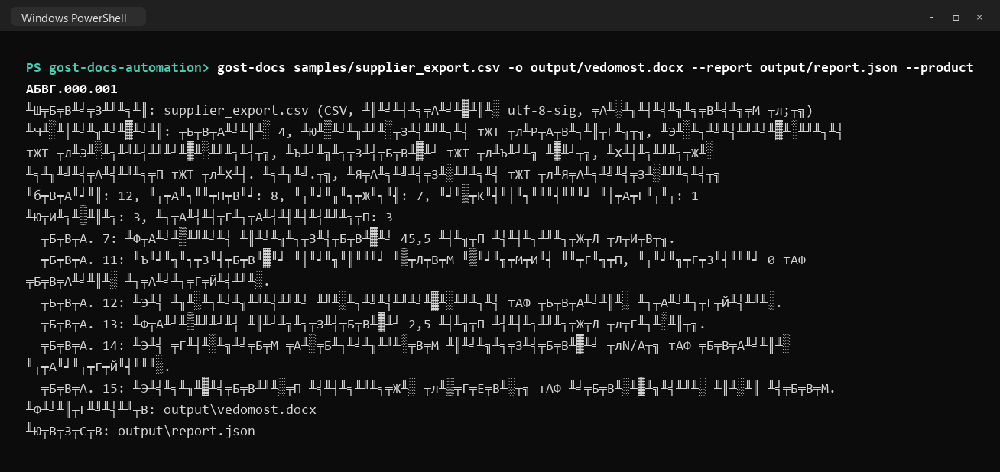
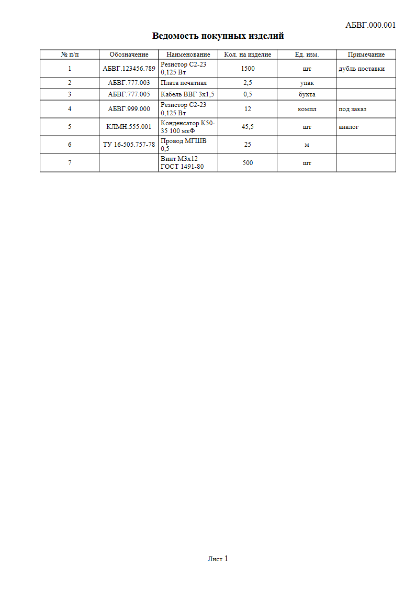
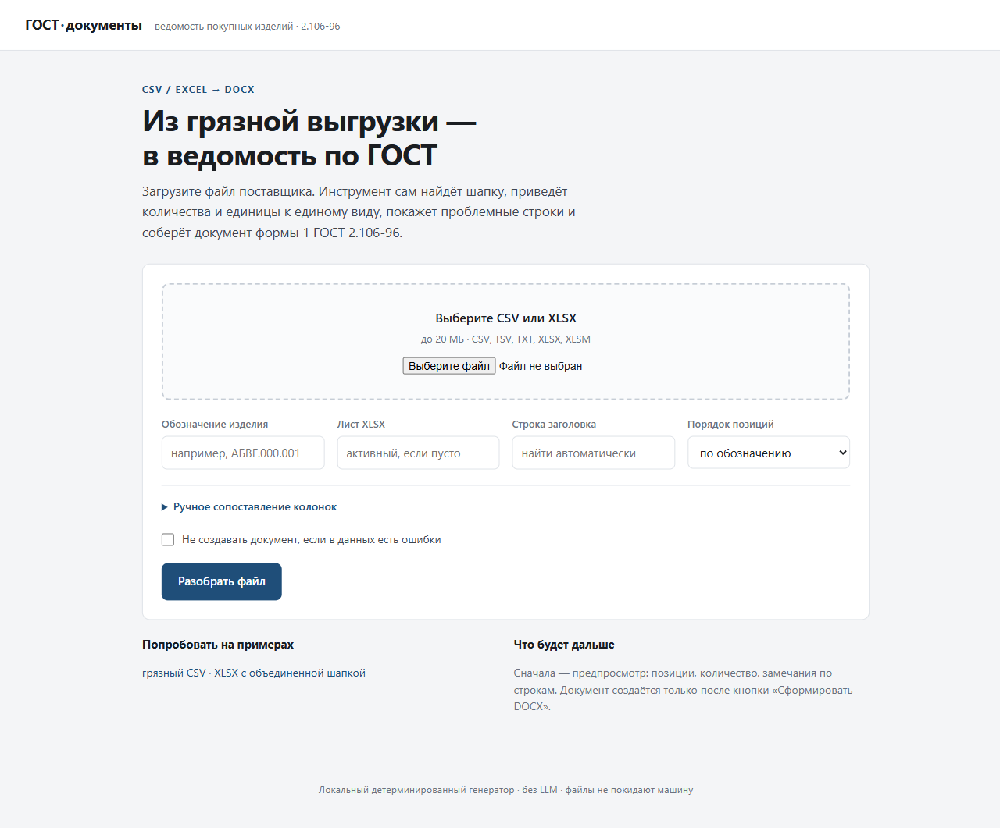
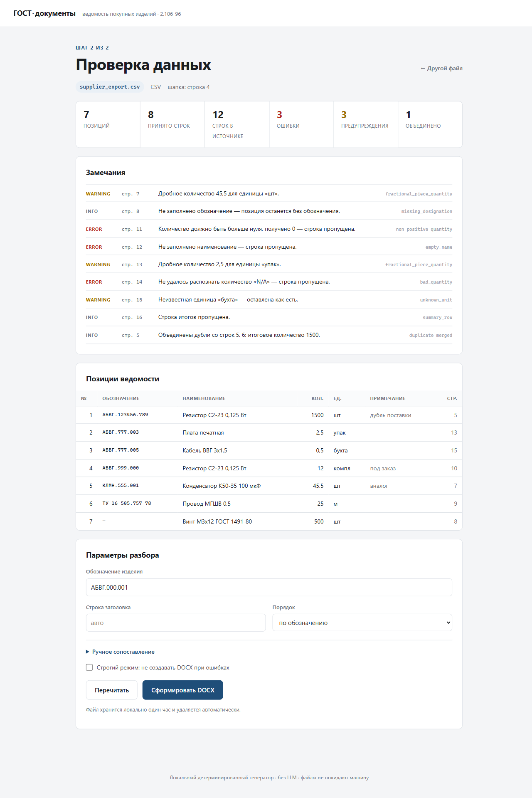
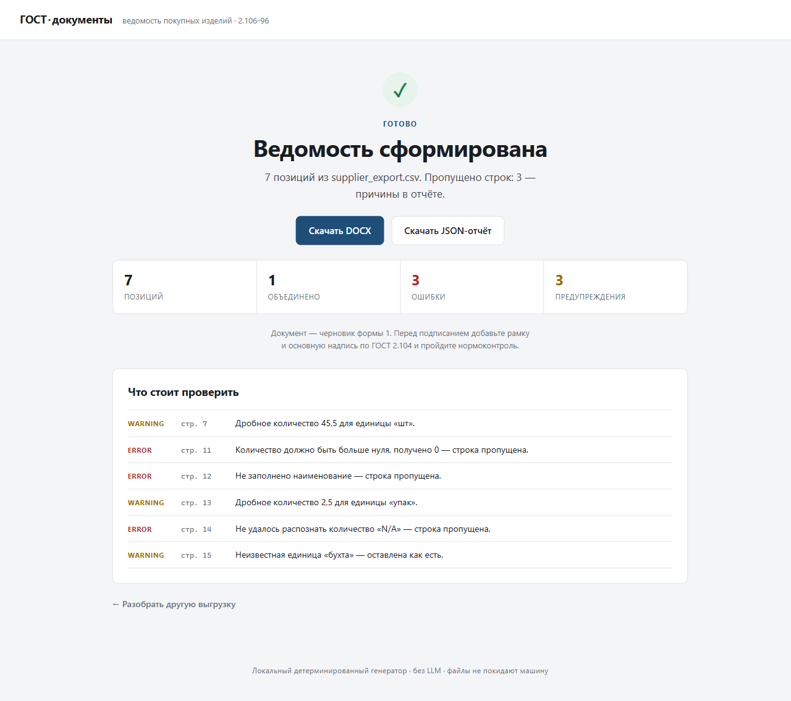

# ГОСТ-документы: ведомость покупных изделий из грязных выгрузок

[](https://github.com/AlexMayPool/gost-docs-automation/actions/workflows/ci.yml)


Инструмент берёт выгрузку из 1С, Excel или самодельный CSV поставщика и
собирает из неё ведомость покупных изделий по ГОСТ 2.106-96 в DOCX.
Работает офлайн, без LLM и без ручной правки таблиц: находит шапку, приводит
обозначения и количества к единому виду, склеивает дубли, складывает количество
и честно отчитывается о строках, которые пришлось выбросить.

```text
$ gost-docs samples/supplier_export.csv -o output/vedomost.docx --report output/report.json
Источник: supplier_export.csv (CSV, кодировка utf-8-sig, разделитель «;»)
Заголовок: строка 4, Обозначение → «Артикул», Наименование → «Наименование», …
Строк: 12, принято: 8, позиций: 7, объединено групп: 1
Ошибки: 3, предупреждения: 3
  стр. 7: Дробное количество 45,5 для единицы «шт».
  стр. 11: Количество должно быть больше нуля, получено 0 — строка пропущена.
  стр. 12: Не заполнено наименование — строка пропущена.
  …
Документ: output/vedomost.docx
Отчёт: output/report.json
```

## Демо

Реальный запуск на [`samples/supplier_export.csv`](samples/supplier_export.csv):

```bash
gost-docs samples/supplier_export.csv \
  -o output/vedomost.docx \
  --report output/report.json \
  --product АБВГ.000.001
```





Терминальный снимок — не макет: это stdout реального запуска, отрендеренный в
изображение. Страница документа получена из сгенерированного DOCX через
LibreOffice, без ручной правки. Подробности — в [`docs/demo.md`](docs/demo.md).

## Веб-интерфейс

Для показа и ручной проверки есть локальная веб-обёртка поверх того же ядра:
загрузка файла → предпросмотр разбора → скачивание DOCX и JSON-отчёта.
Сервер по умолчанию слушает только `127.0.0.1`, файлы лежат во временном
каталоге с TTL один час; авторизации и внешних запросов нет.

```bash
pip install -e ".[web]"
gost-docs-web                 # http://127.0.0.1:8000
gost-docs-web --port 8080     # другой порт
```

| Загрузка | Проверка данных | Результат |
| --- | --- | --- |
|  |  |  |

Скриншоты сняты с реального локального запуска на
[`samples/supplier_export.csv`](samples/supplier_export.csv), без макетов и
ретуши. Предпросмотр показывает те же 7 позиций, 3 ошибки и 3 предупреждения,
что и CLI; кнопка «Сформировать DOCX» вызывает тот же `write_docx`, а не
отдельную реализацию. Проверка `--strict` в веб-форме работает так же: при
ошибках документ не создаётся.

Веб-слой — тонкий: `create_app()` принимает каталог заданий, лимит размера и
TTL, поэтому его можно поднять в тестах без сети и без глобального состояния.
Для боевого использования нужны аутентификация, постоянное хранилище и
очистка по расписанию — здесь сознательно только локальный демо-режим.

## Что умеет

- **Читает то, что реально присылают.** CSV в UTF-8, UTF-8 с BOM и CP1251,
  разделители `;`, `,`, табуляция и `|`. XLSX с выбором листа, объединёнными
  ячейками и шапкой не в первой строке.
- **Сам находит шапку.** Первые 20 строк оцениваются по словарю синонимов
  («Артикул», «Код», «Номенклатура», «Кол-во на изделие», «Ед. изм.» и т. п.).
  Обязательны только «Наименование» и «Количество». Если не угадал — есть
  `--header-row` и `--map`.
- **Нормализует данные.** Верхний регистр и единые дефисы в обозначениях,
  неразрывные пробелы, десятичная запятая, «1 200,5 шт.» → `1200.5` + `шт`,
  словарь единиц (`шт`, `компл`, `упак`, `м`, `кг`, `л`, `рул`, `т`).
- **Склеивает дубли.** Позиции с одинаковыми обозначением, наименованием и
  единицей объединяются, количество суммируется, примечания сохраняются.
- **Объясняет потери.** Каждая пропущенная строка получает код и сообщение:
  пустое наименование, `N/A` в количестве, ноль, дробные штуки, неизвестная
  единица, строка «Итого».
- **Собирает DOCX.** Упрощённая таблица ВП, A4, Times New Roman, повторяющаяся шапка,
  номер листа в колонтитуле.

## Установка

Нужен Python 3.10+.

```bash
python -m venv .venv
# Windows: .venv\Scripts\activate
# Linux/macOS: source .venv/bin/activate

pip install -e .
```

Для тестов: `pip install -e ".[dev]"`. Для веб-интерфейса: `pip install -e ".[web]"`.

## Быстрый старт

```bash
gost-docs samples/supplier_export.csv \
  -o output/vedomost.docx \
  --report output/report.json

gost-docs samples/purchase_list.xlsx \
  --sheet Спецификация \
  -o output/vedomost_xlsx.docx
```

Без установки пакета:

```bash
# Windows PowerShell
$env:PYTHONPATH="src"
py -m gost_docs.cli samples/supplier_export.csv -o output/vedomost.docx

# Linux/macOS
PYTHONPATH=src python -m gost_docs.cli samples/supplier_export.csv -o output/vedomost.docx
```

Если `-o` не указан, файл попадёт в `output/<имя_источника>_vedomost.docx`.

## CLI

```text
gost-docs INPUT [-o OUT] [--report JSON] [--sheet NAME] [--product CODE]
           [--map FIELD=COLUMN] [--header-row N]
           [--sort designation|name|source] [--strict] [--json] [--quiet]
           [--version]
```

| Флаг | Что делает |
| --- | --- |
| `-o, --output` | путь к DOCX; по умолчанию `output/<stem>_vedomost.docx` |
| `--report` | сохранить JSON-отчёт о разборе и замечаниях |
| `--sheet` | лист XLSX; по умолчанию активный |
| `--product` | обозначение изделия в правом верхнем углу |
| `--map` | ручное соответствие, можно повторять: `--map quantity=Кол-во` |
| `--header-row` | номер строки шапки, нумерация с 1 |
| `--sort` | порядок позиций: по обозначению (по умолчанию), наименованию или источнику |
| `--strict` | не создавать DOCX, если есть ошибки в данных |
| `--json` | напечатать отчёт в stdout вместо сводки |
| `--quiet` | напечатать только путь к готовому файлу |

Поля для `--map`: `designation`, `name`, `quantity`, `unit`, `note`. Колонку
можно указать именем или номером: `--map designation=2`.

Коды возврата:

| Код | Значение |
| --- | --- |
| `0` | документ создан |
| `1` | файл не прочитан, шапка не найдена или неверные аргументы |
| `2` | есть ошибки данных и включён `--strict`; DOCX не создаётся |

## Пример данных

В [`samples/`](samples) лежат две специально испорченные выгрузки, обе
генерируются скриптом:

```bash
python scripts/make_samples.py
```

`supplier_export.csv` — преамбула поставщика, лишняя строка `;;`, NBSP в
количестве, десятичные запятые, дубль поставки, пустое обозначение, ноль,
`N/A`, дробные штуки, неизвестная единица «бухта» и строка «Итого».

Ожидаемый результат разбора: 12 непустых строк после шапки, 8 принято,
7 позиций, 1 объединённая группа, 3 ошибки, 3 предупреждения. Резистор из двух
поставок получает количество `1500`.

`purchase_list.xlsx` — объединённые заголовки, данные с 4-й строки, лист
«Спецификация», служебный лист и дубль `АБВГ.100.004`: 6 строк, 5 принято,
4 позиции, 1 объединение, 0 ошибок.

Готовые примеры результата — в [`examples/`](examples):
[`supplier_report.json`](examples/supplier_report.json) и
[`supplier_vedomost.docx`](examples/supplier_vedomost.docx).

## JSON-отчёт

Отчёт задуман как контракт для интеграции: по нему можно строить очередь
ручной проверки, не открывая DOCX.

```json
{
  "tool": "gost-docs-automation",
  "source": {"file": "supplier_export.csv", "format": "csv", "encoding": "utf-8-sig",
             "delimiter": ";", "sheet": null},
  "header": {"line": 4, "columns": {"designation": "Артикул", "name": "Наименование",
             "quantity": "Кол-во", "unit": "Ед. изм.", "note": "Примечание"},
             "unmatched": ["Цена, руб."]},
  "counts": {"source_rows": 12, "accepted_rows": 8, "items": 7,
             "merged_groups": 1, "errors": 3, "warnings": 3},
  "issues": [{"level": "error", "code": "non_positive_quantity",
              "message": "Количество должно быть больше нуля…", "line": 11,
              "column": "Количество"}],
  "items": [{"line": 5, "designation": "АБВГ.123456.789",
             "name": "Резистор С2-23 0,125 Вт", "quantity": "1500",
             "unit": "шт", "note": ""}]
}
```

`level` — `error`, `warning` или `info`. `error` означает, что строка не попала
в документ; `warning` — строка попала, но требует внимания; `info` — действие
инструмента (объединение дублей, пропуск «Итого»).

## Соответствие ГОСТ

Документ собирает упрощённую таблицу ведомости покупных изделий: графы
«№ п/п», «Обозначение», «Наименование», «Кол. на изделие», «Ед. изм.»,
«Примечание»; лист A4, Times New Roman 10 pt в таблице и 14 pt в заголовке,
поля 20/10/10/10 мм, повтор шапки на каждой странице и номер листа в нижнем
колонтитуле.

Это **не** полная форма 5 ГОСТ 2.106-96. В стандартной форме есть графы
«Код продукции», «Обозначение документа на поставку», «Поставщик»,
«Куда входит (обозначение)» и «Количество в комплекте»; здесь их нет —
шаблон рассчитан на черновик, который предприятие дополняет под свой
нормоконтроль.

Что **не** делается:

- нет рамки и основной надписи по ГОСТ 2.104 — их добавляют в шаблоне
  предприятия или вручную перед подписанием;
- нет нормоконтроля, подписей, шифров документов и учёта изменений;
- количество считается «на изделие»: одна ведомость — одно изделие, без
  пересчёта на партию и без спецификации входимости.

Это генератор черновика, а не средство выпуска конструкторской документации.
Перед официальным применением документ должен пройти нормоконтроль.

## Ограничения

- Веб-версия — локальный демо-режим без авторизации и постоянного хранилища:
  не рассчитана на публикацию в интернете.
- Нет OCR и PDF: сканы и фотографии таблиц не читаются.
- Нет интеграции с 1С/ERP: на вход подаётся файл, а не подключение к базе.
- Один табличный блок на файл. Несколько изделий в одном листе не разбираются.
- Словарь единиц фиксированный; экзотическая единица сохраняется как есть с
  предупреждением.
- Пароли и защищённые листы XLSX не поддерживаются.
- Формулы XLSX читаются как значения из кэша (`data_only=True`); если файл
  сохранён без пересчёта, значений может не быть.

## Как это устроено

Схема и решения — в [`docs/architecture.md`](docs/architecture.md). Коротко:

```text
CSV/XLSX → readers → mapping (поиск шапки) → validate (нормализация, дубли)
         → docx_writer (ГОСТ) + report (JSON + сводка)
```

Модули намеренно разделены: чтение не знает про ГОСТ, запись DOCX не знает про
источник, а вся бизнес-логика проверяется на обычных списках строк.

## Тесты

```bash
python -m pytest
```

140 тестов: 108 тестов ядра и 32 теста веб-слоя. Покрыты парсинг количеств и
единиц, кодировки и разделители CSV, объединённые ячейки XLSX, поиск шапки и
`--map`, слияние дублей, коды замечаний, структура DOCX (шрифты, поля, повтор
шапки, колонтитул), коды возврата CLI и JSON-отчёт. Веб-тесты поднимают
приложение через `TestClient` с временным каталогом и проверяют загрузку
CSV/XLSX, выбор листа, лимит размера, строгий режим, скачивание DOCX/JSON и
ошибки.

## Структура

```text
src/gost_docs/
  model.py        dataclasses: Table, Item, Issue, BuildResult
  readers.py      CSV/XLSX → строки
  mapping.py      синонимы, поиск шапки, --map
  normalize.py    количества, единицы, обозначения
  validate.py     проверки, слияние дублей, сортировка
  docx_writer.py  DOCX ВП
  report.py       JSON-отчёт и текстовая сводка
  cli.py          argparse-интерфейс
  web/            локальный веб-интерфейс: app.py, шаблоны, CSS
scripts/make_samples.py
samples/          две грязные выгрузки
examples/         готовый отчёт и DOCX
tests/            140 тестов
```

## Лицензия

MIT. См. [LICENSE](LICENSE).
