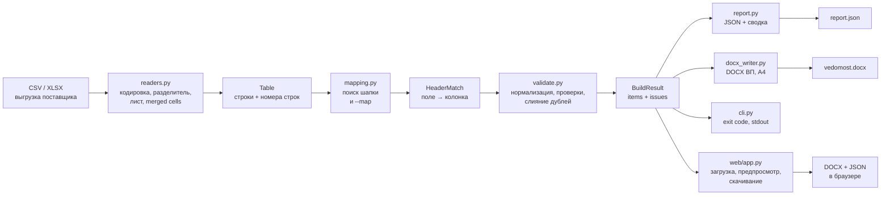
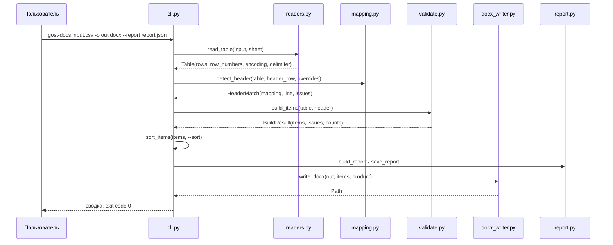
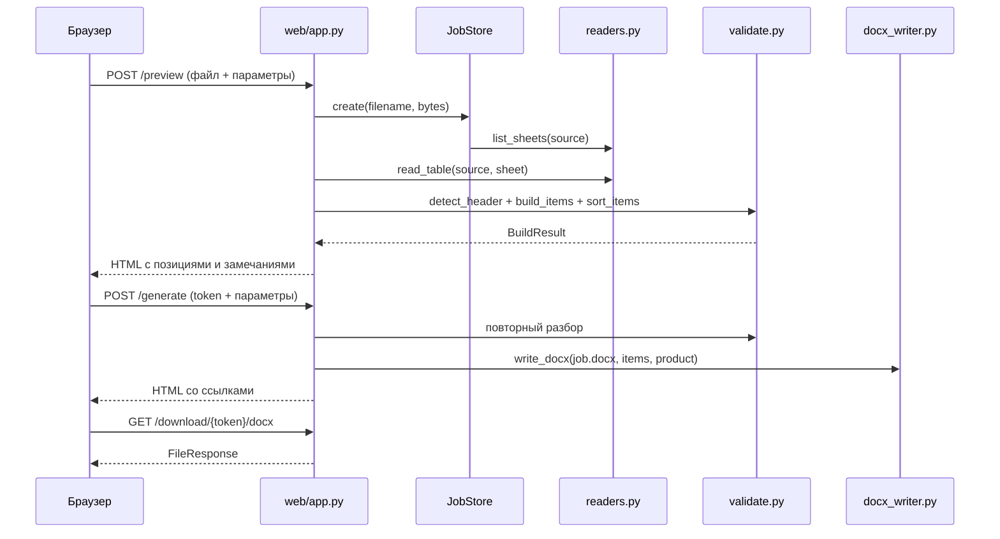

# Архитектура gost-docs-automation

Ядро — конвейер: грязная выгрузка → строки → шапка → нормализованные позиции →
DOCX с таблицей ВП и JSON-отчёт. Никаких сетевых вызовов, LLM и
скрытого состояния: один запуск — один документ. Входов два: CLI для скриптов и
тонкий локальный веб-слой для ручной проверки; оба вызывают одни и те же
модули ядра.

## Компоненты

Модули не зависят друг от друга по цепочке «вниз»: `docx_writer` получает уже
готовые `Item` и не знает, откуда они; `report` не знает про DOCX; `readers` не
знает про ГОСТ. Поэтому каждый слой тестируется отдельно, а CLI и веб-слой
остаются тонкой склейкой.

## Поток запуска

При `--strict` и наличии ошибок запись DOCX не выполняется, возвращается код 2.
Отчёт при этом уже сохранён — его можно отдать на ручную проверку.

## Веб-слой

`web/app.py` — не второй конвейер, а обёртка над теми же функциями:

Особенности демо-режима:

- каждое задание живёт в отдельном каталоге `uuid4().hex`, имя исходного файла
  очищается через `Path(...).name`;
- `JobStore` хранит задания в памяти процесса, ограничивает их число (50) и
  удаляет по TTL (1 час); `lifespan` удаляет каталог при остановке;
- лимит загрузки 20 МБ проверяется по мере чтения, до записи на диск;
- сервер по умолчанию слушает `127.0.0.1`; авторизации нет, наружу выставлять
  нельзя;
- ответы получают `CSP`, `X-Content-Type-Options`, `X-Frame-Options` и
  `Referrer-Policy`; внешних CDN и JS нет;
- при `strict` ошибки данных возвращают 400, DOCX не создаётся — как в CLI.

Предпросмотр и генерация вызывают `analyze()` дважды: это осознанный размен
простоты на повторное чтение небольшого файла. Состояние разбора в сессии не
хранится, поэтому нет риска, что документ собран по устаревшим данным.

## Поиск шапки

Шапка ищется среди первых 20 строк. Каждая ячейка приводится к ключу
(`ё → е`, нижний регистр, удаление пунктуации) и сверяется со словарём
синонимов. Строка получает балл: число распознанных полей плюс 5, если найдены
обязательные «Наименование» и «Количество». Побеждает максимальный балл; при
равенстве — более ранняя строка.

Это даёт устойчивость к преамбуле, пустым строкам и шапке на 4-й строке, но не
к произвольным названиям колонок. Для них есть два выхода:

- `--header-row N` — зафиксировать строку;
- `--map field=column` — указать соответствие по имени или номеру колонки.
  `--map` применяется и к явной, и к автоматически найденной шапке.

Обязательны только `name` и `quantity`: обозначение может отсутствовать
(например, у крепежа), единица может быть внутри количества. Это осознанно:
инструмент не должен падать на реальной выгрузке из-за одной пустой колонки.

## Нормализация

| Что | Правило |
| --- | --- |
| Пробелы | NBSP и узкие пробелы → обычный, схлопывание повторов, обрезка кавычек по краям |
| Обозначение | верхний регистр, `– — −` → `-`, пробелы вокруг `.`, `/`, `-` убираются |
| Количество | `1 200,5`, `1.234,5`, `1,234.5`, `12 компл`; возвращается `Decimal` и подсказка единицы |
| Единица | словарь синонимов: `штук → шт`, `комплект → компл`, `пог.м → м`, `литр → л` и т. п. |
| Неизвестная единица | сохраняется в нижнем регистре с предупреждением |
| Пустая единица | подставляется `шт` с предупреждением |
| Дубли | ключ `(обозначение, наименование.casefold(), единица)`; количества складываются, примечания склеиваются через `; ` |

`Decimal` выбран вместо `float`, чтобы `0,1 + 0,2` и суммы по сотням строк не
давали хвостов. В DOCX и JSON количество выводится с запятой и без хвостовых
нулей: `1500`, `2,5`, `0,125`.

## Замечания

| Код | Уровень | Причина |
| --- | --- | --- |
| `empty_name` | error | пустое наименование |
| `bad_quantity` | error | количество не распознано (`N/A`, текст) |
| `non_positive_quantity` | error | ноль или отрицательное количество |
| `missing_unit` | warning | единица не указана, принята `шт` |
| `unknown_unit` | warning | единицы нет в словаре, сохранена как есть |
| `unit_mismatch` | warning | единица в колонке и в количестве расходятся |
| `fractional_piece_quantity` | warning | дробное количество для `шт`/`компл`/`упак` |
| `duplicate_column` | warning | две колонки претендуют на одно поле, взята первая |
| `missing_designation` | info | позиция останется без обозначения |
| `duplicate_merged` | info | дубли объединены, указаны строки и итог |
| `summary_row` | info | строка «Итого»/«Всего» пропущена |

Ошибка означает, что строка не попала в документ. Предупреждение — строка
попала, но требует внимания. Info — действие инструмента, а не проблема данных.

`source_rows` считает все непустые строки после шапки, включая «Итого» и
отброшенные; `accepted_rows` — только принятые. Разница всегда объяснена в
`issues`.

## DOCX

`docx_writer.py` собирает документ с нуля через `python-docx`:

- A4, поля 20/10/10/10 мм;
- заголовок 14 pt полужирный, изделие — справа 12 pt;
- таблица `Table Grid`, Times New Roman 10 pt, фиксированная ширина граф;
- шапка повторяется на каждой странице (`w:tblHeader`);
- номер листа в нижнем колонтитуле через поле `PAGE`;
- свойства документа заполняются, чтобы файл не был анонимным.

Ширины граф подобраны под форму 1: 12 + 45 + 88 + 20 + 15 мм = 180 мм, что
ровно соответствует ширине листа A4 за вычетом полей 20 + 10 мм.

Сознательно не добавляются рамка и основная надпись по ГОСТ 2.104: их вид
зависит от шаблона предприятия, а рисовать «похожую» рамку — значит выдавать
непроверенный документ за готовый. Это записано и в README.

## Решения

**Почему CLI — основной вход, а веб — надстройка.** Задача — пакетная обработка
выгрузок в скрипте или CI. CLI даёт предсказуемый exit code и JSON. Веб-слой
добавлен для показа и ручной проверки и вызывает те же `read_table`,
`build_items`, `write_docx`; отдельной логики разбора в нём нет. Поэтому
расхождение между «как в CLI» и «как в браузере» невозможно по построению.

**Почему без LLM.** Сопоставление колонок и нормализация должны быть
воспроизводимы и проверяемы: один и тот же файл обязан давать один и тот же
документ. Для нестандартных шапок есть явный `--map`, а не догадки модели.

**Почему свой словарь единиц.** Отраслевые справочники (ОКЕИ) избыточны для
ведомости покупных изделий, а выгрузки используют десяток разговорных форм.
Словарь покрывает их и явно сообщает о неизвестной единице.

**Почему объединение дублей автоматическое.** Дубли — самая частая проблема
выгрузок из 1С: одна позиция приходит из двух поставок. Молча оставить две
строки значит получить неверное количество; молча сложить без следа — скрыть
правку. Поэтому количество суммируется, а в `issues` остаётся запись с номерами
строк.

## Тесты

`tests/` покрывает слои независимо:

- `test_normalize.py` — количества, единицы, обозначения, форматирование;
- `test_readers.py` — кодировки, разделители, merged cells, листы, ошибки;
- `test_mapping.py` — поиск шапки, синонимы, `--map`, конфликты колонок;
- `test_validate.py` — коды замечаний, слияние, сортировки;
- `test_docx.py` — структура таблицы, шрифты, поля, повтор шапки, колонтитул;
- `test_report.py` — JSON и текстовая сводка;
- `test_cli.py` — exit codes, `--strict`, `--json`, `--quiet`, `--sort`,
  `--header-row` + `--map`, путь по умолчанию;
- `test_web.py` — загрузка CSV/XLSX, выбор листа, лимит размера, `strict`,
  скачивание DOCX/JSON, неверные токены и русские формы множественного числа.

Интеграционные тесты используют закоммиченные `samples/`, поэтому проверяют
ровно тот сценарий, который описан в README.
